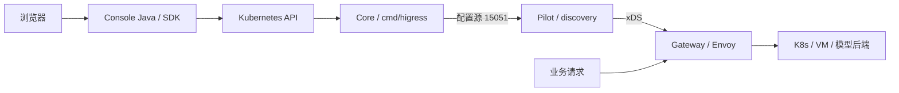

# Higress 本地开发与全链路调试

> 公司内部开发教程。2026-11-01 按 `higress@eb507bf` 与 `higress-console@deffd9b` 核对。本文提供分层调试路径，不宣称已完成运行验证。本次仅阅读源码并编写文档，没有启动组件、运行 E2E 或修改集群。已有构建记录见 [verification.md](verification.md)，其中镜像/Envoy 冒烟结论不能替代本教程的控制面联调验收。

## 1. 全景：先把配置链路与业务链路分开



通常 `higress-controller` Deployment 中包含 Core 与 discovery 两个容器。Core 将 Ingress、服务发现及插件资源转换成配置；Pilot 进一步生成网关 xDS。业务请求只经过 Gateway 和后端。

### 端口表

| 端口 | 进程与用途 | 调试用法 |
|---|---|---|
| 8080 | Console Java API | 绑定本机回环 |
| ICE 启动日志中的端口 | Console 前端 | `/api` 代理至 8080 |
| 8888 | Core HTTP/debug | 不是 Console 默认依赖的 15014 |
| 8889 | Core 证书 HTTP 服务 | 避免本机冲突 |
| 15051 | Core 配置源 gRPC | Pilot 连接到这里 |
| 15014 | Pilot 监控/查询 HTTP | Console 会用到；本地 Pilot 与 port-forward 不能重复占用 |
| 15010 / 15012 | Pilot 明文 / TLS xDS 常见端口 | 本教程 HTTP 实验使用隔离环境的 15010 |
| 15000 | Envoy admin | 仅本地 port-forward 查看配置与状态 |
| 18080 | 本文选择的本地业务转发端口 | 映射 Gateway Service HTTP 端口 |

**业务流量走网关不等于控制面接管成功。**Envoy 可以继续使用旧配置，因此必须修改一条测试路由，看到断点命中和配置更新才算成功。

## 2. 前置准备与版本核对

每个新终端设置：

```bash
export HIGRESS_REPO=/home/teaho/IdeaProjects/teaho-infra/higress
export CONSOLE_REPO=/home/teaho/IdeaProjects/teaho-infra/higress-console
export DEV_KUBECONFIG="$HOME/.kube/higress-dev.yaml"
export KUBECONFIG="$DEV_KUBECONFIG"
export HG_NS=higress-system
export DEBUG_DIR="$HOME/.cache/higress-local-debug"
mkdir -p "$DEBUG_DIR"
chmod 700 "$DEBUG_DIR"
cd "$HIGRESS_REPO"
git rev-parse HEAD
git status --short
go version
kubectl config current-context
kubectl --request-timeout=10s cluster-info
kubectl -n "$HG_NS" get deploy,pod,svc
```

`DEV_KUBECONFIG` 必须预先准备且只指向独立开发集群。`DEBUG_DIR` 仅保存本次调试文件，若以前用过应换一个新目录。

### 2.1 版本和源码准备

当前根 `go.mod`、`istio/istio/go.mod` 声明 Go **1.26.0**，以代码要求为准，不沿用旧教程工具链。Delve/GoLand 需支持所用 Go；遇到版本不支持，升级兼容工具，不用关闭版本检查掩盖问题。WASM 和 Go filter 使用各自模块/构建镜像，不能假定与 Core 工具链相同。

2026-11-01 检查时 `istio/istio/pilot/cmd/pilot-discovery/main.go` 存在，但 `external/istio/...` 尚未准备好。Root module 的 replace 引用了 external，不能跳过准备直接编译。

```bash
cd "$HIGRESS_REPO"
git submodule status
rg '^replace|=> ./external|^go ' go.mod
# 在已保存当前改动、网络依赖可用的开发 checkout 内执行
make prebuild
# 完成后检查真实编译目录
 test -f external/istio/pilot/cmd/pilot-discovery/main.go
 git diff -- go.mod go.sum
```

当前 `tools/hack/prebuild.sh` 复制 submodule 到 `external/` 并执行 `go mod tidy`，不是旧文章中的补丁流程。脚本会跳过已经存在的目录，残缺的 external 可能无法靠重跑修复。先保存个人修改，再仅备份/移动确认损坏的目录；不要无差别删除 external 或重置整个仓库。

`docs/walmart/prepare-source.sh` 是 Docker 构建阶段脚本，硬编码 `/src` 与 `/out`，不要在宿主机直接执行。企业离线准备按 [README.md](README.md)，本地调试只需准备相应 Go 源码与依赖，无需每次重新构建 Envoy。

修改 Pilot 时，本地 IDE 实际编译的是 `external/istio`。这里的改动不会自动回写到 `istio/istio` submodule；保存 patch 并按项目约定同步回真正受版本管理的源码。不要只改 external 后就认为修改已提交。

### 2.2 取得真实启动配置并保存恢复材料

```bash
kubectl -n "$HG_NS" get cm higress-config -o json > "$DEBUG_DIR/higress-config.before.json"
kubectl -n "$HG_NS" get deploy higress-controller -o json > "$DEBUG_DIR/controller.before.json"
kubectl -n "$HG_NS" get deploy higress-gateway -o json > "$DEBUG_DIR/gateway.before.json"
kubectl -n "$HG_NS" get deploy higress-controller \
  -o jsonpath='{range .spec.template.spec.containers[*]}{.name}{"\t"}{.image}{"\n"}{end}'
```

在本地查看保存的 `args`、`env`，敏感值不贴到工单。本文假定 Deployment/ConfigMap 名称为默认名称，自定义 release 应替换。Core 容器名由 Chart 产生，先查名称，不要把它固定写成 `controller`。

开发集群若启用 Argo CD/Flux，应暂停本次调试资源的自动同步或使用独立实例，否则本地接管配置会被还原。操作结束恢复同步。

## 3. 模式 A：只调 Console，保留集群控制面

按 [Console 本地开发教程](../../../higress-console/docs/walmart/local-development-debugging.md) 启动前后端。集群 Core/Pilot/Gateway 均不改。用一条普通 HTTP 路由跑通页面、K8s 写入、网关响应，建立基线。

先完成这个模式，再增加本地 Core 或 Pilot。这样可以判断故障来自业务配置还是调试网络。

## 4. 模式 B：本地 Core，集群 Pilot/Gateway

```text
Console → K8s API → 本地 Core:15051 ← 集群 Pilot → 集群 Gateway
```

### 4.1 启动本地 Core

GoLand 打开根仓库，Go Build 配置：

| 配置项 | 内容 |
|---|---|
| Run kind | Package |
| Package path | `github.com/alibaba/higress/v2/cmd/higress` |
| Working directory | `$HIGRESS_REPO` 的实际绝对路径 |
| Environment | `POD_NAMESPACE=higress-system;POD_NAME=higress-core-local`，其他变量对照部署 |
| Program arguments | 见下方 |

```text
serve --kubeconfig=/home/teaho/.kube/higress-dev.yaml --ingressClass=higress --gatewaySelectorKey=higress --gatewaySelectorValue=higress-system-higress-gateway --enableStatus=false --httpAddress=127.0.0.1:8888 --grpcAddress=0.0.0.0:15051
```

`gatewaySelectorValue` 必须匹配真实网关 label。`--enableStatus=false` 避免本地与集群 Core 重复写 Ingress status。其他 watch namespace、Gateway API 开关等按实际部署对齐。

命令行 Delve 等价示例：

```bash
cd "$HIGRESS_REPO"
POD_NAMESPACE="$HG_NS" POD_NAME=higress-core-local \
  dlv debug ./cmd/higress -- \
  serve --kubeconfig="$DEV_KUBECONFIG" --ingressClass=higress \
  --gatewaySelectorKey=higress --gatewaySelectorValue=higress-system-higress-gateway \
  --enableStatus=false --httpAddress=127.0.0.1:8888 --grpcAddress=0.0.0.0:15051
```

Delve 控制台执行 `continue`。调试器连接绑定本机；15051 仅向开发集群节点网络开放。

### 4.2 让集群 Pilot 连接本地 Core

找出 **Pod 能访问的开发主机地址**，记为 `DEV_HOST_IP`。Pod 内 `127.0.0.1` 指 Pod 自己；`kubectl port-forward` 只能实现主机访问 Pod，不能解决 Pod 反向访问主机。

```bash
ip -br address
ss -lntp | rg '15051|8888'
# 用实际可达地址替换，不能原样执行
export DEV_HOST_IP=替换为Pod可达的主机IP
```

用开发集群里已经具备 `nc` 的诊断 Pod 验证 `nc -vz "$DEV_HOST_IP" 15051`。没有诊断工具时，使用团队批准的诊断镜像。kind bridge、Minikube VM、VPN 与防火墙都可能影响这条反向路径；先测通再改配置。

```bash
kubectl -n "$HG_NS" edit cm higress-config
```

只在 `data.mesh` 的 `configSources` 中把 Core 的一条地址改为实际主机地址，保留可能存在的 `k8s://` 等其他源：

```yaml
configSources:
  - address: "xds://开发主机IP:15051"
```

重启并确认集群 Pilot 重新读取配置：

```bash
kubectl -n "$HG_NS" rollout restart deployment/higress-controller
kubectl -n "$HG_NS" rollout status deployment/higress-controller --timeout=180s
```

Gateway 的发现地址没变，本模式通常不需要为了 Core 换址重启 Gateway。确需重连时再单独执行并记录。

Core 与 Pilot 分别可能仍监听 K8s 事件，因此“断点命中”只是一个证据。要同时确认集群 Pilot 连接的是本地 15051，并且本地转换结果进入 Envoy。不要把整个 Controller Deployment 缩为 0，因为 Pilot 也在其中。

### 4.3 推荐断点

| 文件 | 观察点 |
|---|---|
| `pkg/cmd/server.go` | 参数、namespace、class 是否与部署一致 |
| `pkg/ingress/kube/ingressv1/controller.go` | Ingress 事件、筛选与缓存 |
| `pkg/ingress/config/ingress_config.go` | `List`、`convertVirtualService`、`convertEnvoyFilter`、`convertWasmPlugin` |
| `pkg/ingress/kube/wasmplugin/controller.go` | WasmPlugin 的变更事件 |
| `registry/consul/` | Consul 服务发现结果；与 Connect 透明代理能力分开看 |

在 Console 修改测试路由，或仅修改已创建的专用测试 Ingress；观察资源版本变化、Core 转换结果与 Pilot 推送。配置下发线程暂停会导致 ACK 延迟，先放行断点再判断健康。

### 4.4 hgctl 自动接管的适用范围

当前 `hgctl/pkg/code_debug.go` 提供 start/stop，仅适合由 hgctl 以 `local-k8s` profile 安装的环境，并会自动选择网卡地址、修改配置及重启工作负载。

```bash
hgctl code-debug start --kubeconfig="$DEV_KUBECONFIG"
# 完成调试后
hgctl code-debug stop --kubeconfig="$DEV_KUBECONFIG"
```

Helm 安装或多网卡环境优先使用上面的手动方法。该版本某些错误路径打印错误后仍返回 nil，不能只检查退出码或“Code debug started”文字，要核对 ConfigMap、连接和 rollout。stop 恢复默认地址，不等于恢复自定义配置，最终以调试前备份为准。

## 5. 模式 C：本地 Pilot，Gateway 留在集群

推荐先让集群 Core 保持正常，只调 Pilot：

```text
集群 Core:15051 ← port-forward ← 本地 Pilot:15010 ← 集群 Gateway
```

### 5.1 导出配置与接通 Core

```bash
kubectl -n "$HG_NS" get cm higress-config -o jsonpath='{.data.mesh}' > "$DEBUG_DIR/mesh"
kubectl -n "$HG_NS" get cm higress-config -o jsonpath='{.data.meshNetworks}' > "$DEBUG_DIR/meshNetworks"
kubectl -n "$HG_NS" port-forward --address 127.0.0.1 deployment/higress-controller 15051:15051
```

检查本地 `mesh` 的 Core `configSources` 为 `xds://127.0.0.1:15051`。如果此前是模式 B，应先恢复，或明确将本地 Pilot 指向仍在本地运行的 Core，此时不启动 15051 转发。

### 5.2 GoLand / Delve 启动 Pilot

打开准备好的 `external/istio` 模块。入口 `pilot/cmd/pilot-discovery/main.go`。Working directory 为该模块根，启动参数：

```text
discovery --kubeconfig=/home/teaho/.kube/higress-dev.yaml --monitoringAddr=127.0.0.1:15014 --grpcAddr=0.0.0.0:15010 --domain=cluster.local --meshConfig=/home/teaho/.cache/higress-local-debug/mesh --networksConfig=/home/teaho/.cache/higress-local-debug/meshNetworks --log_output_level=default:info
```

先用当前二进制 `discovery --help` 核对 flags。环境变量从 `controller.before.json` 的 **discovery 容器**逐项对照，不复制 Secret/token。用于普通 HTTP 路由实验的起始配置：

```text
POD_NAME=higress-pilot-local
POD_NAMESPACE=higress-system
REVISION=default
JWT_POLICY=none
VALIDATION_ENABLED=false
PILOT_ENABLE_GATEWAY_API=false
PILOT_ENABLE_GATEWAY_API_STATUS=false
PILOT_ENABLE_GATEWAY_API_DEPLOYMENT_CONTROLLER=false
```

该配置仅用于隔离 HTTP 实验：`PILOT_ENABLE_GATEWAY_API=false` 表示此时不调 Gateway API；测试 Gateway API 时应对齐 Chart 开关和 CRD，再单独处理 status/deployment controller 的写入责任。证书、CA、注入等其他启动要求仍以当前源码与实际启动错误为准，不能认为这组环境变量覆盖所有功能。

```bash
cd "$HIGRESS_REPO/external/istio"
POD_NAME=higress-pilot-local POD_NAMESPACE="$HG_NS" REVISION=default \
JWT_POLICY=none VALIDATION_ENABLED=false PILOT_ENABLE_GATEWAY_API=false \
PILOT_ENABLE_GATEWAY_API_STATUS=false PILOT_ENABLE_GATEWAY_API_DEPLOYMENT_CONTROLLER=false \
  dlv debug ./pilot/cmd/pilot-discovery -- discovery \
  --kubeconfig="$DEV_KUBECONFIG" --monitoringAddr=127.0.0.1:15014 \
  --grpcAddr=0.0.0.0:15010 --domain=cluster.local \
  --meshConfig="$DEBUG_DIR/mesh" --networksConfig="$DEBUG_DIR/meshNetworks" \
  --log_output_level=default:info
```

模式 A 的 15014 port-forward 要先退出，本地 Pilot 将占用该端口。Console 此时查询本地 Pilot。先验证本地 Pilot 已加载 Core 配置，再接 Gateway。

### 5.3 让 Gateway 连接本地 Pilot

此步骤修改的是 **`mesh.defaultConfig.discoveryAddress`**，不是上一节的 `configSources`。

在独立开发集群编辑 `higress-config`，保留其余字段：

```yaml
defaultConfig:
  discoveryAddress: "开发主机IP:15010"
  controlPlaneAuthPolicy: NONE
```

这一明文控制面配置只适用于隔离的本地调试环境。限制主机 15010 的可达来源，不向生产或共享网关应用。验证 Pod 到该地址可达后：

```bash
kubectl -n "$HG_NS" rollout restart deployment/higress-gateway
kubectl -n "$HG_NS" rollout status deployment/higress-gateway --timeout=180s
```

用本地 Pilot 的连接日志、Envoy bootstrap/config_dump 验证发现地址，不能仅凭 Pod Running 判断。实际 Gateway 环境变量/启动参数可能覆盖 mesh 默认值，若地址未生效，检查保存的 Deployment 与 Envoy bootstrap。

普通 HTTP 路由的推荐断点：

- `external/istio/pilot/pkg/xds/ads.go`：`StreamAggregatedResources`、`initConnection`。
- `external/istio/pilot/pkg/networking/core/`：按当前源码搜索 route/listener/cluster 生成函数。
- `external/istio/pilot/pkg/bootstrap/`：配置源和启动参数加载。

旧博客修改 `VerifiedIdentity` 绕过证书认证的方法不列为默认步骤。HTTP 调通不代表 SDS/TLS 调通。需要调证书时，优先在专用集群内运行带调试符号的 Pilot，保留真实 ServiceAccount、挂载证书及 TLS xDS，调试器端口仅经回环 port-forward；临时调试 Pod 还需处理 readiness/liveness 暂停和网络访问策略。

### 5.4 Console + Core + Pilot 同时本地

| 项目 | 配置 |
|---|---|
| Console | 本地 8080，kubeconfig 指向开发集群，查询本地 Pilot 15014 |
| Core | 本地 15051，读取同一 kubeconfig |
| Pilot 本地 mesh | `configSources: xds://127.0.0.1:15051` |
| Gateway | 集群内，discoveryAddress 指向 Pod 可达的主机 15010 |
| port-forward | 不再占用本地 15051 / 15014，只保留业务端口和 Envoy admin |

建议顺序：Core 启动并 ready，Pilot 加载配置，Gateway 连上，Console 最后提交变更。每一跳先用日志确认，再上断点。

## 6. Envoy 数据面观测与插件开发

先查 Gateway Pod 与容器名，再转发其 admin：

```bash
kubectl -n "$HG_NS" get pods
export GATEWAY_POD=替换为实际GatewayPod名称
kubectl -n "$HG_NS" port-forward --address 127.0.0.1 pod/"$GATEWAY_POD" 15000:15000
```

另一终端：

```bash
curl -fsS http://127.0.0.1:15000/config_dump > "$DEBUG_DIR/config_dump.json"
curl -fsS 'http://127.0.0.1:15000/clusters?format=json' > "$DEBUG_DIR/clusters.json"
curl -fsS 'http://127.0.0.1:15000/stats?filter=update_rejected'
rg 'debug.gateway.test|debug-route' "$DEBUG_DIR/config_dump.json"
```

config_dump 可能包含内部拓扑与敏感配置，仅本地保存。需要查看：listener 是否存在，virtual host/route 是否匹配，cluster 是否存在，endpoint 是否健康，以及 xDS 是否 NACK。SDK 保存成功、Pilot 生成成功、Envoy ACK 和请求成功必须分别确认。

```bash
kubectl -n "$HG_NS" port-forward --address 127.0.0.1 svc/higress-gateway 18080:80
```

```bash
curl -sv -H 'Host: debug.gateway.test' -H 'X-Request-ID: local-debug-001' \
  http://127.0.0.1:18080/debug
```

`80` 是示例 Service port，按实际服务修改。遇到 404 区分路由未命中与上游 404；503 区分无端点、连接失败、TLS 失败及限流/熔断。结合 access log 的 `response_flags`、`response_code_details`、`upstream_cluster` 定位。

### 6.1 WASM 与 Go filter

- Go WASM 插件位于 `plugins/wasm-go/extensions/<name>`，每个插件有独立 go.mod。先对配置解析、请求处理 helper 写单元测试，再编译 WASM，通过独立测试路由验证。
- 在 `plugins/wasm-go` 下执行 `PLUGIN_NAME=<实际目录名> make build`。这是构建操作，不自动代表插件已被 Gateway 使用。不要执行 `build-push`，除非确需推送到指定开发 registry。
- WasmPlugin 的 `url` 必须指向实际构建产物。OCI 模式使用新版本/tag 或 digest，避免旧缓存；`file:///opt/plugins/...` 模式需事先验证 Gateway 已挂载对应文件。
- `make install-dev-wasmplugin` 会改变 Helm 部署并挂载开发插件，应仅用在专用测试集群。批量 Go WASM 构建脚本只选 `VERSION` 以 `-alpha` 结尾的插件，单插件 build 与批量 build 不能混为一谈。
- Delve 可调原生 Go 单元测试，但不能直接附加 Envoy 内的 WASM 实例。WASM 运行时用测试、日志、配置转储及专门工具定位。
- `plugins/golang-filter` 是原生 `.so`，不是 WASM。按其 Dockerfile/ABI 工具链编译，参考现有企业构建指南。Envoy C++ 需要符号二进制及 gdb/lldb，超出 Core/Pilot 的 Go 调试流程。

AI 插件先使用可控 mock 模型服务，逐项验证 SSE 首帧、完整结束、中断、超时、客户端取消及 Token 用量。只调通普通 JSON 不能证明流式处理正确，不用真实生产模型凭据做调试。

## 7. 复用环境运行 E2E，不再改测试源码跳过 setup

当前 `test/e2e/conformance/utils/flags/flags.go` 已有 `--test-area=setup|run|clean|all` 和 `--execute-tests`。`test/e2e/e2e_test.go` 使用 build tag `conformance`。

先检查测试网络：`test/e2e/e2e_test.go` 当前把 `GatewayAddress` 写成 `localhost`，普通 HTTP 请求实际访问本机 80，HTTPS 用例访问 443。上一节的 18080 仅用于手工 curl，测试不会自动采用它。优先使用测试集群已有的 80/443 映射；没有映射时，可在独立终端转发：

```bash
kubectl --kubeconfig="$DEV_KUBECONFIG" -n "$HG_NS" \
  port-forward --address 127.0.0.1 svc/higress-gateway 80:80
```

本机绑定低端口可能需要系统授权，且 80 必须未被其他服务占用。由管理员按公司开发机策略处理，不能为此长期用 root 运行 IDE。若只允许高端口，可在个人调试分支临时把测试入口的 `GatewayAddress` 改成 `127.0.0.1:18080` 并使用上一节转发，调完撤销该行；当前没有可直接传入的 gateway-address flag。HTTPS/重定向用例还需分别核对端口和证书，不能认为高端口改动适用所有测试。

在现有专用 Higress 开发集群中运行：

```bash
cd "$HIGRESS_REPO"
export KUBECONFIG="$DEV_KUBECONFIG"
# 创建基础测试资源，包含多个测试 namespace 和依赖服务
# 当前 setup 分支已强制 Cleanup=false；此处显式参数用于表达复用意图
 go test -v -tags conformance ./test/e2e/e2e_test.go \
  -args --ingress-class=higress --debug=true \
  --test-area=setup --cleanup-base-resources=false

# 只跑一个真实 ShortName，便于断点调试
 go test -v -tags conformance ./test/e2e/e2e_test.go \
  -args --ingress-class=higress --debug=true \
  --test-area=run --execute-tests=HTTPRouteCanaryHeader \
  --cleanup-base-resources=false

# 确认不再复用后清理测试资源，不删除整个集群
 go test -v -tags conformance ./test/e2e/e2e_test.go \
  -args --ingress-class=higress --test-area=clean
```

不要反复运行 setup 而不清理旧资源，否则不可变 Pod 字段可能冲突。`--execute-tests` 限定用例，不会自动把 setup 所有依赖裁剪到只剩该用例。查看 `conformance/utils/suite/suite.go` 的 BaseManifests 了解依赖。

仓库也提供 `run-higress-e2e-test-setup/run/clean` Make 目标。当前入口在 setup 分支强制 `Cleanup=false`，不会因 flags 的默认 true 而立即清理；上面显式传 false 是为了表达复用意图。默认 all 模式会按清理设置注册退出清理。`*-prepare` 目标可能先删除并重建 kind 集群；执行前查看 Makefile，不把它用于共享环境。

GoLand 配置 Go Test：File=`test/e2e/e2e_test.go`，Working directory=根仓库，Build tags=`conformance`，Environment 设置专用 `KUBECONFIG`，Program arguments 填 `--test-area=run --execute-tests=HTTPRouteCanaryHeader --cleanup-base-resources=false --debug=true`。先从命令行完成 setup，再用 IDE Debug 跑测试。

新增用例参考 `test/e2e/conformance/tests/` 中成对 `.go`/`.yaml`，填写唯一 `ShortName`，覆盖正例、错误配置、回退和资源清理。WASM 用例还需正确设置插件语言/名称及产物。不要只改现有测试的全局默认 flag 来实现个人调试。

## 8. Consul Connect 与公司网络的专项验证

社区 E2E 中 Consul 注册中心用例只证明服务发现，不等价于公司的 Connect 透明代理。

分两层验证：先用普通开发后端证明 Console/Core/Pilot/Gateway 配置链路，再在公司开发环境让 **Gateway 出站经既定 Connect 透明代理**访问 K8s 和 VM。

| 检查项 | 证据 |
|---|---|
| 发现正确 | Core 获取的服务实例、端口与 Envoy endpoints 一致 |
| 出站确实被代理 | Connect sidecar/代理连接记录，而非只看业务 200 |
| K8s / VM 都可访问 | 各执行一次同样的请求并记录后端身份 |
| mTLS / intentions 正确 | 放行场景成功，拒绝场景按预期失败 |
| 故障定位 | 分辨 Gateway → 本地透明代理、代理 → 后端两段 |
| 路由/灰度变更生效 | 版本命中与用户标记符合预期，无跨版本回退异常 |

本地 Core/Pilot 接管控制面，不会自动把开发主机纳入 Mesh。不要为了调通请求修改生产 intentions 或把绕过透明代理的直连路径当作验收结果。

## 9. 恢复与故障排查

优先恢复本次修改的 mesh 字段。如果是你独占的开发集群、期间没有其他人改同一个 ConfigMap，可以从备份生成只恢复 `.data` 的 merge patch：

```bash
python3 - "$DEBUG_DIR" <<'PY'
import json, pathlib, sys
p = pathlib.Path(sys.argv[1])
saved = json.loads((p / 'higress-config.before.json').read_text())
(p / 'restore-data.patch.json').write_text(json.dumps({'data': saved['data']}))
PY
kubectl -n "$HG_NS" patch cm higress-config --type=merge \
  --patch-file "$DEBUG_DIR/restore-data.patch.json"
kubectl -n "$HG_NS" rollout restart deployment/higress-controller
kubectl -n "$HG_NS" rollout status deployment/higress-controller --timeout=180s
kubectl -n "$HG_NS" rollout restart deployment/higress-gateway
kubectl -n "$HG_NS" rollout status deployment/higress-gateway --timeout=180s
```

merge patch 不删除备份中不存在的新 data key；如本次新增过 key，应审查后单独清理。若期间有他人变更，只恢复你修改的 `configSources` / `defaultConfig` 字段，不能覆盖整份 data。

确认 Gateway 已连接集群 Pilot、新路由可正常下发后，再关本地 Core/Pilot。恢复 GitOps 同步、清理本次测试资源与转发进程。不要执行 `git reset --hard` 清理调试改动。

| 现象 | 排查顺序 |
|---|---|
| Core/Pilot 编译失败 | Go 版本、external 是否完整、replace 指向、公司模块代理 |
| Core 没收到事件 | kubeconfig、RBAC、namespace、ingressClass、watch 配置 |
| 本地 Core 命中但行为不变 | Pilot 是否仍连集群 Core、是否收到新配置、Gateway 是否 NACK |
| Pilot 连不上 Core | 主机/POD 网络方向、15051 监听、port-forward 冲突 |
| Gateway 连不上 Pilot | discoveryAddress、主机可达地址、15010、TLS 策略与覆盖配置 |
| Console 查询失败 | 15014 是本地 Pilot 还是转发到旧实例 |
| TLS/SDS 被拒绝 | 身份、ServiceAccount、证书链与认证模式，不能用 HTTP 实验结论推断 |
| E2E 资源消失 | 是否误用 all 模式或执行 clean；当前 setup 已强制关闭清理 |
| 流式 AI 请求卡住 | 首帧、buffering、超时、取消传播、上游连接状态 |

## 10. 学习顺序、参考与验收单

建议一天一个小闭环：先完成 Console 路由创建，然后 Core 条件断点，再 Pilot xDS 断点，最后一个 E2E 用例和一个插件变更。每次只接管一层，确认恢复能力后再组合。

参考：

- [Console 官方教程](https://higress.ai/blog/console-dev)
- [E2E 官方教程](https://higress.cn/blog/e2e-debug)，同文可通过 [higress.ai](https://higress.ai/blog/e2e-debug/) 阅读
- [Pilot 官方教程](https://higress.ai/blog/pilot-debug/)
- 本地依据：`pkg/cmd/server.go`、`helm/core/templates/configmap.yaml`、`helm/core/templates/controller-deployment.yaml`、`hgctl/pkg/code_debug.go`、`Makefile.core.mk`、`test/e2e/conformance/utils/flags/flags.go`、`tools/hack/prebuild.sh`

这些早期文章提供思路，执行命令以当前 checkout 为准。若后续向上游贡献代码/文档，遵守仓库 `AGENTS.md` 和 `docs/developers/agent-assisted-contributions.md` 的 Proposal/Design/TASK 与 AI 参与披露流程；本次是本地公司内部教程，不发起上游贡献或 PR。

| 验收项 | 当前状态 | 实测证据填写 |
|---|---|---|
| 代码路径、flag、端口与本地版本对应 | 已静态核对 | 提交号： |
| Console 保存并读取同一条路由 | 待运行 | 请求、资源版本： |
| Core 转换断点命中 | 待运行 | 断点、配置结果： |
| Pilot 下发且 Envoy ACK | 待运行 | 连接、版本、config_dump： |
| HTTP 请求与 AI SSE 场景 | 待运行 | 响应、日志： |
| E2E 单用例 | 待运行 | 命令、用例、结果： |
| 恢复至集群控制面 | 待运行 | 发现地址、请求结果： |
| 公司 Connect K8s / VM | 待验证 | 透明代理/mTLS/intentions： |
